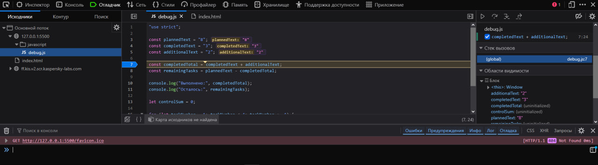

# Практическая работа № 1 — Отчёт

## Автор и вариант

- Имя: Старых Егор Викторович
- Группа: ЭФБО-12-25
- Вариант: 6 (`totalTasks = 18`, `completedTasks = 6`, `dailyLimit = 5`)

## Окружение

- ОС: Windows 10
- Node.js: v24.21.0
- npm: 11.19.0
- Git: 2.53.0.windows.2
- Браузер: Firefox [версия] (DevTools для отладки)

## Запуск

Из корня репозитория:

```bash
node practice-01/js/hello.js
node practice-01/js/types.js
node practice-01/js/progress.js
node practice-01/js/plan.js
node practice-01/js/debug.js
```

В браузере: открыть `practice-01/index.html`, заменить `src` в теге `script` на нужный файл, перезагрузить страницу, смотреть Console (F12).

## Задание 1

| Среда | `typeof document` |
|---|---|
| Node.js | `undefined` |
| Браузер | `object` |

`document` — часть браузерного DOM API. В Node.js DOM отсутствует, поэтому значение `undefined`.

## Задание 2

| Выражение | Ожидание | Факт | Тип | Объяснение |
|---|---|---|---|---|
| `"8" + 2` | `"82"` | `"82"` | string | `+` со строкой — конкатенация |
| `"8" - 2` | `6` | `6` | number | `-` приводит операнды к числу |
| `Number("8") + 2` | `10` | `10` | number | явное преобразование |
| `"12" > "3"` | `false` | `false` | boolean | строки сравниваются посимвольно: `"1" < "3"` |
| `12 === "12"` | `false` | `false` | boolean | строгое равенство без приведения типов |
| `Number("")` | `0` | `0` | number | пустая строка → 0 |
| `Number("text")` | `NaN` | `NaN` | number | нечисловая строка → NaN |
| `Boolean("false")` | `true` | `true` | boolean | любая непустая строка истинна |
| `typeof null` | `"object"` | `"object"` | string | историческая особенность языка |
| `typeof NaN` | `"number"` | `"number"` | string | NaN — числовое значение |

## Задание 3

Вариант 6: `18 / 6` → осталось 12, прогресс 33.3%, статус «В работе».

| # | Входные | Ожидание | Факт | Итог |
|---|---|---|---|---|
| 1 | 18 / 6 | 33.3%, В работе | 33.3%, В работе | Пройдено |
| 2 | 0 / 0 | Задач пока нет | Задач пока нет | Пройдено |
| 3 | 5 / 0 | 0.0%, Не начато | 0.0%, Не начато | Пройдено |
| 4 | 5 / 5 | 100.0%, Завершено | 100.0%, Завершено | Пройдено |
| 5 | 5 / 6 | Ошибка | Ошибка | Пройдено |
| 6 | -1 / 0 | Ошибка | Ошибка | Пройдено |
| 7 | 5 / 2.5 | Ошибка | Ошибка | Пройдено |
| 8 | "5" / 2 | Ошибка | Ошибка | Пройдено |
| 9 | 1001 / 0 | Ошибка | Ошибка | Пройдено |
| 10 | NaN / 0 | Ошибка | Ошибка | Пройдено |

## Задание 4

Вариант 6: `18 / 6 / 5` → 3 дня.

| # | Входные | Ожидание | Факт | Итог |
|---|---|---|---|---|
| 1 | 18 / 6 / 5 | 3 дня | 3 дня | Пройдено |
| 2 | 10 / 4 / 3 | 2 дня | 2 дня | Пройдено |
| 3 | 5 / 3 / 10 | 1 день | 1 день | Пройдено |
| 4 | 5 / 5 / 2 | 0 дней | 0 дней | Пройдено |
| 5 | 0 / 0 / 2 | 0 дней | 0 дней | Пройдено |
| 6 | 5 / 2 / 0 | Ошибка | Ошибка | Пройдено |
| 7 | 5 / 2 / 1.5 | Ошибка | Ошибка | Пройдено |
| 8 | 5 / 6 / 2 | Ошибка | Ошибка | Пройдено |
| 9 | 5 / 2 / "2" | Ошибка | Ошибка | Пройдено |
| 10 | 5 / 2 / 1001 | Ошибка | Ошибка | Пройдено |

## Отладка

Исходный (неверный) вывод:

```
Выполнено: 32
Осталось: -24
Контрольная сумма: 6
```

Исправленный вывод:

```
Выполнено: 5
Осталось: 3
Контрольная сумма: 10
```

| Ошибка | Что наблюдалось | Причина | Исправление | Результат |
|---|---|---|---|---|
| Обработка количества | `completedTotal = "32"`, `remainingTasks = -24` | `+` со строками выполняет конкатенацию, а не сложение | `Number(completedText) + Number(additionalText)` | `5`, `3` |
| Граница цикла | `controlSum = 6` | `taskNumber < 4` останавливается на 3 | Заменил `<` на `<=` | `10` |



## Вывод

Освоены запуск JavaScript в Node.js и браузере, работа с типами и преобразованиями, условия, циклы, проверка входных данных, отладка через точки останова. Наиболее показательной оказалась ошибка с конкатенацией строк: `+` со строковыми операндами даёт текст, а не число, что повлияло и на расчёт остатка.